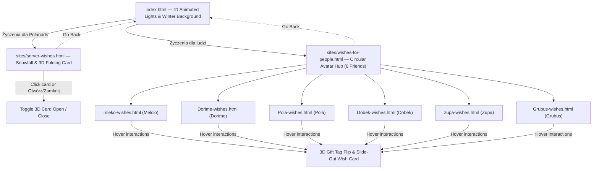

# Polaroids Christmas

[](https://dudek03.github.io/PolaroidsChristmass/)
[](https://developer.mozilla.org/en-US/docs/Web/HTML)
[](https://sass-lang.com/)
[](https://developer.mozilla.org/en-US/docs/Web/JavaScript)

A warm, festive multi-page Christmas greeting web experience crafted for the **Polaroids** friend group. Built with pure HTML, CSS/Sass animations, and vanilla JavaScript, it combines twinkling string lights, falling snow, an interactive 3D-folding group Christmas card, and six personalized friend wish pages with flippable holiday gift tags and hover-reveal portrait cards.

> **Visit the live holiday site:** [https://dudek03.github.io/PolaroidsChristmass/](https://dudek03.github.io/PolaroidsChristmass/)

---

## Features & Interactive Highlights

- **Twinkling Christmas Light Rope (`index.html`)**: Dynamically generates 41 glowing CSS-animated bulbs (`flash-1`, `flash-2`, `flash-3`) across the top of an animated winter background (`assets/background.gif`).
- **3D Folding Group Greeting Card (`sites/server-wishes.html`)**: Features a multi-layer animated CSS snowfall backdrop (`#snow`) and a 3D perspective Christmas card that smoothly swings open (`rotateY(-180deg)`) when clicking the card or toggling the **Otwórz / Zamknij** button.
- **Circular Friends Avatar Hub (`sites/wishes-for-people.html`)**: Displays 6 glowing circular friend portraits arranged in a ring with festive red-and-green hover glows.
- **6 Personalized Wish Pages (`sites/*-wishes.html`)**: Dedicated holiday cards for **Melcio (Mleko)**, **Dorime**, **Pola**, **Dobek**, **Zupa**, and **Grubus**, each styled with its own palette, custom holiday sticker illustrations, and two CSS 3D/hover interactions:
  - **Flippable 3D Gift Tag**: Hovering over the hanging holiday tag flips it `180°` in 3D space to reveal a playful personal nickname.
  - **Hover-Reveal Portrait Card**: Hovering over the glassmorphic card slides the friend's portrait aside and glides their personalized Polish Christmas message into view.
- **Automated GitHub Pages Deployment**: Published automatically on pushes to `master` via `.github/workflows/jekyll-gh-pages.yml`.

---

## Site Navigation & Interaction Flow



---

## Tech Stack

- **Markup**: HTML5 (multi-page static site, zero build step required)
- **Styling & Animations**: CSS3, SCSS (`style/style.scss`), and indented Sass (`style/server-wishes.sass`) with compiled `.css` outputs
- **Interactivity**: Vanilla JavaScript (`JS/main.js`, `JS/serverWishes.js`, `JS/peopleWishes.js`, `JS/goBackButton.js`)
- **Typography**: Google Fonts (*Poppins* and *Dancing Script*)
- **Hosting**: GitHub Pages via GitHub Actions (`jekyll-gh-pages.yml`)

---

## Project Structure

```text
PolaroidsChrismass/
├── .github/workflows/
│   └── jekyll-gh-pages.yml      # GitHub Pages deployment workflow
├── index.html                   # Festive landing page with animated light rope
├── JS/
│   ├── main.js                  # Generates 41 light bulbs & landing navigation
│   ├── serverWishes.js          # Toggles the 3D group Christmas card open/close
│   ├── peopleWishes.js          # Routes avatar clicks to each friend's wish page
│   └── goBackButton.js          # Shared history.back() navigation helper
├── sites/
│   ├── server-wishes.html       # Group Christmas card with CSS snowfall
│   ├── wishes-for-people.html   # 6-friend circular portrait selector
│   ├── mleko-wishes.html        # Personalized wish page (Melcio)
│   ├── Dorime-wishes.html       # Personalized wish page (Dorime)
│   ├── Pola-wishes.html         # Personalized wish page (Pola)
│   ├── Dobek-wishes.html        # Personalized wish page (Dobek)
│   ├── zupa-wishes.html         # Personalized wish page (Zupa)
│   └── Grubus-wishes.html       # Personalized wish page (Grubus)
├── style/
│   ├── general.css              # Shared glowing buttons & icon positioning
│   ├── style.scss / style.css   # Landing lightrope keyframes & avatar ring layout
│   ├── server-wishes.sass/.css  # 3D folding card & parallax snowfall animation
│   └── *-wishes.css             # Individual themes, 3D gift tags & hover cards
└── assets/                      # Winter background GIF, friend avatars & holiday stickers
```

---

## Running Locally

Because this is a pure static site with compiled CSS included, no package installation or build step is needed.

1. Clone the repository:

   ```bash
   git clone https://github.com/Dudek03/PolaroidsChristmass.git
   cd PolaroidsChristmass
   ```

2. Open `index.html` directly in your browser, **or** serve the directory with any lightweight local static server:

   ```bash
   # Using VS Code Live Server, Python, or npx serve
   python -m http.server 8080
   # or
   npx serve .
   ```

3. Visit `http://localhost:8080` (or the port shown by your static server) and explore the holiday wishes!

> **Tip:** If you edit `style/style.scss` or `style/server-wishes.sass`, recompile them to `.css` with Sass (or the VS Code Live Sass Compiler extension) to see your changes.
